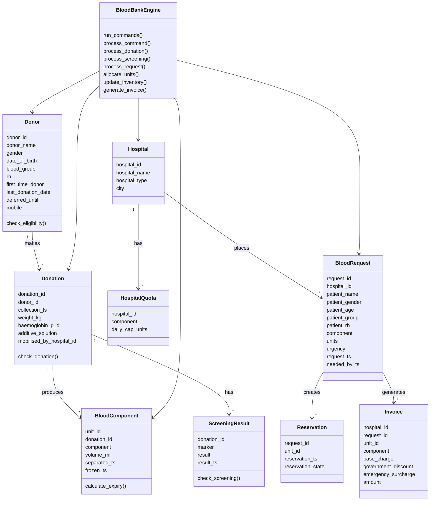

# T088 – PS-063

# Blood Bank Inventory and Cross-Match Allocation Engine

## 1. Project Overview

The Blood Bank Inventory and Cross-Match Allocation Engine is a
Python-based system designed to manage blood donations, blood
components, inventory, hospital requests, and blood allocation.

The system ensures that blood units are properly screened,
stored, tracked, and allocated to hospitals according to
blood group compatibility, urgency, expiry dates, and
hospital requirements.

## 2. Project Objectives

1. Register donors and validate their eligibility.
2. Record blood donations and separate them into components.
3. Manage infection screening and quarantine.
4. Track component availability and expiry dates.
5. Process hospital requests and allocate compatible units.
6. Manage cross-matching and reservations.
7. Generate stock reports and hospital invoices.

## 3. Technology Stack

- Programming Language: Python 3.13
- Testing Framework: pytest
- Development Environment: Visual Studio Code
- Input Format: CSV files
- Output Format: CSV files

## 4. System Modules

### 4.1 Donor Management
Registers donors and checks their eligibility before accepting donations.

### 4.2 Donation Management
Records blood donations and manages the separation of whole blood into PRBC, FFP, and PLATELET components.

### 4.3 Screening Management
Records TTI screening results and manages the quarantine or disposal of donated blood components.

### 4.4 Inventory Management
Tracks available blood components, storage conditions, expiry dates, and stock levels.

### 4.5 Hospital Request Management
Accepts blood requests from hospitals and records their urgency and requirements.

### 4.6 Cross-Match and Allocation
Checks blood group compatibility, manages reservations, and allocates suitable blood units.

### 4.7 Billing and Reporting
Calculates hospital charges and generates stock reports, allocation reports, and invoices.

## 5. Class Diagram

The following classes represent the major entities and
operations of the Blood Bank Inventory and Cross-Match
Allocation Engine.



## 6. State Diagram

The state diagram represents the different states of a blood
component during its lifecycle.

```mermaid
stateDiagram-v2

    [*] --> QUARANTINE

    QUARANTINE --> AVAILABLE : All 5 TTI markers non-reactive
    QUARANTINE --> DISCARDED : Any marker reactive
    QUARANTINE --> DISCARDED : Platelets exceed 72 hours without results

    AVAILABLE --> CROSSMATCHED : Routine/Urgent PRBC reservation
    AVAILABLE --> ISSUED : Emergency allocation

    CROSSMATCHED --> ISSUED : Unit allocated
    CROSSMATCHED --> AVAILABLE : Reservation expires after 72 hours

    ISSUED --> RETURNED : Returned within 30 minutes with cold chain
    ISSUED --> DISCARDED : Late return or cold chain broken

    RETURNED --> AVAILABLE : Successfully restocked

    AVAILABLE --> EXPIRED : Shelf life ends
    CROSSMATCHED --> EXPIRED : Shelf life ends

    DISCARDED --> [*]
    EXPIRED --> [*]
    ```

## 7. Business Rule Register

The following business rules define the conditions and
operations of the Blood Bank Inventory and Cross-Match
Allocation Engine.

| Rule ID | Business Rule | Description |
|---|---|---|
| BR-01 | Donor Eligibility | Validate donor age, weight, haemoglobin, donation interval and deferral status. |
| BR-02 | Component Shelf Life | Calculate expiry dates for PRBC, FFP and Platelets based on storage rules. |
| BR-03 | TTI Screening | Quarantine donations until all five screening markers are non-reactive. |
| BR-04 | Blood Compatibility | Check ABO and Rh compatibility between donor units and patients. |
| BR-05 | Allocation Priority | Select compatible units using identical group preference, stock availability and earliest expiry. |
| BR-06 | Cross-Matching | Manage PRBC reservations, reservation expiry and emergency allocation. |
| BR-07 | Request SLA | Process emergency, urgent and routine requests within their specified time limits. |
| BR-08 | Hospital Quota | Enforce daily hospital supply limits and monthly replacement-donation ratios. |
| BR-09 | Minimum Stock | Generate shortage and critical stock alerts based on inventory levels. |
| BR-10 | Processing Charges | Calculate component charges, government discounts, emergency surcharges and returns. |
| BR-11 | Reservation Conflicts | Prevent double reservations and allow emergency pre-emption of routine reservations. |
| BR-12 | Platelet Pooling | Allow pooling of same-group platelet units with expiry dates within 24 hours. |

### Business Rule Implementation Approach

Each business rule will be implemented as a separate
validation or processing function wherever practical.

Unit tests will be created for every business rule,
including normal scenarios and boundary cases.

Each test case will refer to its corresponding BR-ID.

## 8. Design Decisions

| Decision ID | Decision | Reason |
|---|---|---|
| D-01 | Python 3.13 will be used. | It satisfies the Python 3.10+ requirement. |
| D-02 | CSV files will be used for input data. | The company has provided sample data in CSV format. |
| D-03 | pytest will be used for testing. | It supports automated testing of business rules. |
| D-04 | The application will use a modular architecture. | It makes the system easier to maintain and test. |
| D-05 | Blood components will be tracked individually. | Each component has different shelf-life and allocation rules. |
| D-06 | Business rules will have unique BR-IDs. | This makes implementation and testing traceable. |
| D-07 | Output reports will be generated in CSV format. | This follows the required output structure. |

## 9. Glossary

| Term | Meaning |
|---|---|
| Donor | A person who gives blood. |
| Donation | Blood collected from an eligible donor. |
| PRBC | Packed Red Blood Cells, a component separated from whole blood. |
| FFP | Fresh Frozen Plasma, a plasma component stored frozen. |
| Platelets | Blood components that help in clotting. |
| TTI | Transfusion Transmitted Infection screening. |
| ABO | Blood group classification: A, B, AB and O. |
| Rh Factor | Positive or negative classification of blood. |
| Quarantine | Temporary storage status while screening is pending. |
| Cross-Matching | Testing compatibility between donor blood and recipient blood. |
| Reservation | Temporarily holding a blood unit for a hospital request. |
| FEFO | First Expiry, First Out; selecting the unit that expires earliest. |
| SLA | Service Level Agreement; the allowed time to process a request. |
| Deferral | Temporary or permanent restriction on a donor donating blood. |
| Blood Allocation | Assigning compatible blood units to hospital requests. |